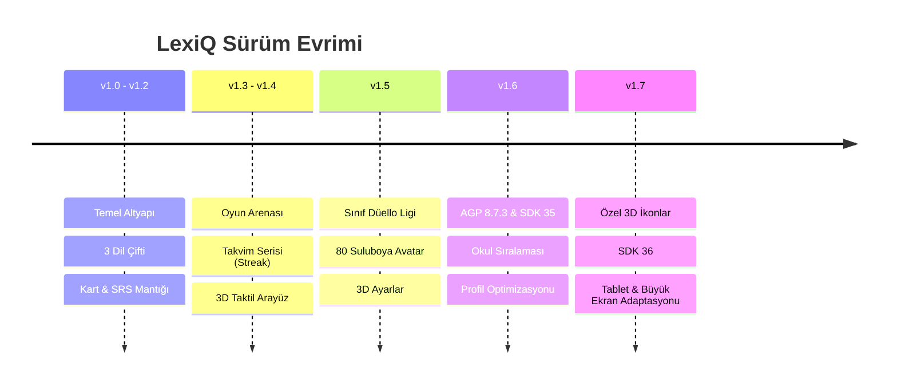

# 📜 LexiQ — Sürüm Geçmişi ve Geliştirme Günlüğü (Changelog)

**Proje:** LexiQ • Çok Dilli Akıllı Kelime Arenası (EN-TR, DE-TR, FR-TR)  
**Tarih Aralığı:** Eylül 2026 – Ekim 2026  
**En Güncel Sürüm:** v1.7.9 (Build 59)  
**Desteklenen Platformlar:** Android (APK / Google Play AAB), Web (PWA), iOS (Web App)

---

## 📌 İçindekiler
1. [Sürümlerin Genel Özeti ve Dönüm Noktaları](#1-sürümlerin-genel-özeti-ve-dönüm-noktaları)
2. [Detaylı Sürüm Günlüğü (v1.0.0 – v1.7.9)](#2-detaylı-sürüm-günlüğü-v100--v179)
3. [Modül ve Özellik Bazlı Gelişim Matrisi](#3-modül-ve-özellik-bazlı-gelişim-matrisi)
4. [Teknik ve Altyapı Standartları](#4-teknik-ve-altyapı-standartları)

---

## 1. Sürümlerin Genel Özeti ve Dönüm Noktaları

---

## 2. Detaylı Sürüm Günlüğü (v1.0.0 – v1.7.9)

### 🚀 v1.7 Ailesi — Büyük Ekran Adaptasyonu, SDK 36 & 3D İkon Sistemi

#### **v1.7.9 (Build 59) — 13 Ekim 2026** *(En Güncel Sürüm)*
- **Cümle Kurma Tablet & Büyük Ekran Adaptasyonu:**
  - 7+ kelimeli cümlelerde küçük telefon ekranlarını korumak için yazılmış olan `.scramble-compact`, `.scramble-dense` ve `.scramble-ultra-dense` stilleri `@media (max-width: 599px)` içine hapsedildi.
  - Tablet ve masaüstü ekranlarda (`min-width: 600px` ve `min-width: 840px`), kelime butonlarının ve harflerinin minicik kalması önlendi; yuvaya giren kelimeler (`.scramble-slot-item`) ve kelime bankası butonları (`.scramble-chip`) `clamp(1.3rem, 2.4vw, 1.75rem)` boyutuna ve `52-58px` dokunma yüksekliğine çıkarıldı.
  - Cümle çevirisi metni okunaklı `clamp(1.4rem, 2.4vw, 1.85rem)` font büyüklüğüne getirildi.
  - Geri Al ve Sıfırla kontrol butonları tablet ekranına göre ferah boyutlandırıldı.

#### **v1.7.8 (Build 58) — 13 Ekim 2026**
- **Kelime Eşleştirme Oyunu Onarımı:** Eşleştirme modülünde kelimelerin ekrana gelmesini engelleyen `selectedWords` referans hatası giderildi, kelimeler eksiksiz yüklenir hale getirildi.
- **Başlık Etiketlerinin Sadeleştirilmesi:** Kelime Eşleştirme oyun ekranında yer alan "Hedef Dil" ve "Türkçe Karşılığı" hap etiketleri tamamen kaldırıldı, temiz oyun görünümüne dönüldü.

#### **v1.7.7 (Build 57) — 13 Ekim 2026**
- **Oyun Alanı Stil Çakışması Giderimi:** Tablet adaptasyonu sırasında ortaya çıkan ve gizli oyun modüllerinin aynı anda görünerek ekranın karışmasına sebep olan `.game-active-area` CSS çakışması `display: none !important` kuralıyla çözüldü.

#### **v1.7.6 (Build 56) — 13 Ekim 2026**
- **Uygulama İçi Canlı Güncelleme:** iOS ve Web kullanıcıları için dış bağlantılara ihtiyaç duymadan uygulama içerisinden önbelleği temizleyip anında en son sürüme geçiş sağlayan tek tıkla güncelleme ve yeniden yükleme akışı kuruldu.

#### **v1.7.5 (Build 55) — 13 Ekim 2026**
- **GitHub Yönlendirmelerinin Kaldırılması:** Güncelleme ekranlarındaki tüm "GitHub Deposunu Aç" bağlantıları ve butonları kaldırıldı; kullanıcıların doğrudan uygulama içi veya mağaza akışında kalması sağlandı.

#### **v1.7.4 (Build 54) — 12 Ekim 2026**
- **Kelime Eşleştirme Düzeni:** Sol sütunda hedef dil kelimeleri (İngilizce/Almanca/Fransızca), sağ sütunda ise Türkçe karşılıkları olacak şekilde 2 sütunlu sabit ızgara mimarisi kuruldu.
- **Tablet Oyun Tipografisi:** Eşleştirme kartları, Boşluk Doldurma ve Anagram ekranlarında harf ve buton boyutları büyük ekranlar için `clamp` ölçekleriyle genişletildi.

#### **v1.7.3 (Build 53) — 12 Ekim 2026**
- **Hakkında (About) Tam Ekran Tasarımı:** Hakkında modali tam ekran kart tasarımına kavuşturuldu.
- **Gizlilik Politikası Entegrasyonu:** Sistem/Ayarlar sekmesinde bulunan Gizlilik Politikası bağlantısı ve bilgilendirme kartı Hakkında ekranına taşındı.

#### **v1.7.2 (Build 52) — 12 Ekim 2026**
- **Android Target SDK 36:** Google Play Console'un yeni gereksinimi doğrultusunda `compileSdk 36` ve `targetSdk 36` yapılandırmasına geçildi.

#### **v1.7.1 (Build 51) — 12 Ekim 2026**
- **Liderlik Tablosunda Yeni Avatarlar:** Suluboya avatarların liderlik tablosu ve turnuva listelerinde görünmesini engelleyen yol ve veri eşleşmesi giderildi.
- **Genel Oyun Ekranı Adaptasyonu:** Oyun kartlarının dikey ve yatayda ekranı dengeli kullanması sağlandı.

#### **v1.7.0 (Build 50) — 12 Ekim 2026**
- **3D Özel İkon Sistemi:** Uygulamadaki düz sembollerin yerine özel tasarlanmış derinlikli 3D ikon seti entegre edildi (İpucu, ses, süre, liderlik, ayarlar vb.).

---

### 🎨 v1.5 – v1.6 Ailesi — Turnuva Ligi, 80 Suluboya Avatar & 3D Ayarlar

#### **v1.6.3 (Build 49) — 12 Ekim 2026**
- **Liderlik Tablosu Varsayılan Sekmesi:** Liderler tablosu açıldığında doğrudan "Okul" genel sıralaması gelecek şekilde varsayılan sekme ayarlandı.

#### **v1.6.2 — 12 Ekim 2026**
- **Gradle & Derleme Modernizasyonu:** Android Gradle Plugin (AGP) 8.7.3 sürümüne yükseltildi, derleme hızı optimize edildi.

#### **v1.6.1 (Build 47) — 12 Ekim 2026**
- **Profil Avatarı Kalıcılığı:** Seçilen avatarın yeniden başlatmalarda kaybolmaması için yerel depolama ve Firestore senkronizasyonu güçlendirildi.
- **Okul Logosu Senkronizasyonu:** Hoş geldin ve Hakkında pencerelerindeki okul logosu görsel yolları standardize edildi.

#### **v1.6.0 — 12 Ekim 2026**
- **Öğrenci Profil Avatar Boyutlandırması:** Header ve profil düzenindeki avatar görselleri için sabit en-boy ve taşma engelleme kuralları getirildi.

#### **v1.5.9 — 12 Ekim 2026**
- **Kart Arka Yüzü (Card-Back) Taşma Koruması:** Uzun Türkçe çevirilerin kartın altına taşmasını önleyen dinamik satır yüksekliği ve yazı boyutu optimizasyonu yapıldı.

#### **v1.5.8 — 12 Ekim 2026**
- **Kompakt Kelime Kartları:** Kart yükseklikleri mobil ekranlara tam sığacak şekilde dengelendi, tur bilgi balonlarının konumları düzeltildi.

#### **v1.5.6 (Build 42) & v1.5.7 — 12 Ekim 2026**
- **80 Adet Özel Suluboya Karakter Avatarı:** 8 farklı tematik kategoride (Öğrenciler, Bilim İnsanları, Sanatçılar, Sporcular, Gezginler, vb.) 80 adet özel suluboya avatar çizimi sisteme eklendi ve profil modalına entegre edildi.

#### **v1.5.5 (Build 41) — 11 Ekim 2026**
- **Sürüm Kontrolü ve Türkçe Karakter Düzeltmesi:** Sürüm aynı olduğunda çıkan yanlış güncelleme uyarıları giderildi, UTF-8 karakter kodlaması ve emojiler garanti altına alındı.

#### **v1.5.4 (Build 40) — 11 Ekim 2026**
- **3D Derinlikli Ayarlar Ekranı:** Ayarlar modali 4 sekmeli modern 3D yapıya kavuşturuldu (Profil, Kartlar, Arena, Hatırlatıcı, Sistem).
- **Gereksiz Kartların Temizliği:** Sistem sekmesindeki karmaşık yedekleme blokları sadeleştirildi.

#### **v1.5.2 & v1.5.3 (Build 38-39) — 11 Ekim 2026**
- **Müfredat ve Veri Temizliği:** Almanca veri tabanındaki hatalı çeviriler düzeltildi.
- **Onboarding Adım 5 & 6:** Günlük seri sözü (Streak Pledge) motivasyon kutusu ve günlük çalışma hatırlatıcısı eklendi.
- **Kart Sayacı:** Günlük hedef kelime dilimleme mantığı ve kalan kelime sayacı kusursuzlaştırıldı.

#### **v1.5.0 (Build 36) & v1.5.1 (Build 37) — 10 Ekim 2026**
- **Sınıf İçi Liderlik Tablosu:** Öğrencilerin kendi hazırlık şubesindeki sınıf arkadaşlarıyla yarışabildiği sınıf ligi eklendi.
- **23 Resmi Şube Haftalık Düello Turnuvası:** Aynı dildeki 23 resmi şubenin adil ortalama XP puanıyla kapıştığı canlı şube ligi kuruldu.
- **Turnuva Rehberi & Onur Listesi Arşivi:** Geçmiş haftaların şampiyon şubelerini saklayan onur köşesi ve kurallar modali oluşturuldu.

---

### 🎮 v1.3 – v1.4 Ailesi — Oyun Arenası, Seri Sistemi & 3D Taktil Tasarım

#### **v1.4.7 – v1.4.9 (Build 33-35) — 8-9 Ekim 2026**
- **3D Taktil Görsel Devrim:** Açık ve koyu temalarda tüm butonlar, kartlar ve kutular basılabilir 3D düğme hissiyatına kavuşturuldu.
- **Google Play Store Entegrasyonu:** Android sürümünde güncellemelerin doğrudan Google Play Store üzerinden yapılmasını sağlayan altyapı kuruldu.
- **Çoklu Ekran Uyumu (Screen Fit):** Küçük ve büyük cihazlarda tek tıkla arayüz ölçekleme motoru ayarlar menüsüne eklendi.

#### **v1.4.3 – v1.4.6 — 7-8 Ekim 2026**
- **Açık Tema Kontrast Güçlendirmesi:** Açık temadaki metin ve buton kontrastları WCAG standartlarına uygun hale getirildi.
- **Tur ve Rehber Balonları:** Fransızca ve Almanca dillerine özel karşılama balonları ve arena turu katmanları tamamlandı.
- **Uzaktan Sürüm Kontrolü:** `version.json` üzerinden uzaktan güncelleme kontrol mekanizması faaliyete geçti.

#### **v1.4.0 – v1.4.2 — 7 Ekim 2026**
- **Güvenlik ve Profil Yönetimi:** Şifre değiştirme, şifre sıfırlama, 4 dilli uygunsuz isim filtresi eklendi.
- **Liderlik Tablosunda Dil Bayrakları:** Öğrencilerin çalıştığı dili gösteren ülke bayrağı rozetleri eklendi.
- **3D Çıkış Onay Modalı:** Yanlışlıkla uygulamadan çıkmayı önleyen şık onay penceresi geliştirildi.

#### **v1.3.7 – v1.3.9 — 6 Ekim 2026**
- **Takvim Tabanlı Günlük Seri (Daily Study Streak):** Bulut senkronizasyonlu zinciri kırma serisi ve özel seri rozetleri eklendi.
- **Duolingo Tarzı Dinamik Uygulama İkonu UI:** Uygulama içerisinde seviye ve seriye göre değişen dinamik rozet deneyimi sağlandı.
- **Arena Ayarları & Font Ölçeklendirme:** Kullanıcının oyunlardaki yazı tiplerini (küçük, normal, büyük, çok büyük) ayarlayabileceği özel seçenekler geliştirildi.
- **Oyun İçi Puan Cezası ve Dinamik Teşvik:** Yanlış cevaplarda -1 XP cezası ve tekrarlamayan motivasyon sloganları eklendi.

#### **v1.3.4 – v1.3.6 — 5 Ekim 2026**
- **Kutlama Ekranı (Goal Complete View):** Günlük hedef tamamlandığında konfetiler ve başarı kartı eşliğinde kutlama ekranı oluşturuldu.
- **LexiQ Admin Hub Web Uygulaması:** Öğrenci kelime ilerlemelerini ve istatistiklerini izlemek için Admin Paneli web platformu hazırlandı.
- **Misafir Öğrenci Modu:** Giriş yapmadan denemek isteyenler için sıfırlanabilir misafir modu sunuldu.

#### **v1.3.0 — 4 Ekim 2026**
- **8 Farklı Pratik ve Oyun Modu:**
  1. Kelime Eşleştirme (Word Matching)
  2. Boşluk Doldurma (Sentence Cloze)
  3. Cümle Kurma (Sentence Scramble)
  4. Anagram (Kelime Türetme)
  5. Doğru / Yanlış (True / False)
  6. 4 Şıklı Test (Multiple Choice Quiz)
  7. Dinleme & Yazma (Audio Spelling)
  8. Kelime Tetrisi (Word Fall / Tetris)

---

### 🏗️ v1.0 – v1.2 Ailesi — Temel Altyapı ve Çekirdek Kurulum

#### **v1.1.0 – v1.1.1 — 2 Ekim 2026**
- **Üçlü Dil Desteği:** İngilizce-Türkçe (EN-TR), Almanca-Türkçe (DE-TR) ve Fransızca-Türkçe (FR-TR) dil çiftleri ve açılış dil seçim ekranı kuruldu.
- **Müfredat Ünite Kuralı:** Üniteler arası geçişte en az %75 öğrenilme barajı mantığı işlendi.

#### **v1.0.0 – v1.0.1 — 30 Eylül – 1 Ekim 2026**
- **İlk Vanilla JS Mimarisi:** Harici framework kullanmaksızın saf HTML5, CSS3 ve Vanilla JS ile mobil öncelikli responsive altyapı oluşturuldu.
- **Flashcard & SRS (Aralıklı Tekrar) Çekirdeği:** `words_data.js` veri tabanı, telaffuz Web Speech API entegrasyonu ve ilk Android WebView APK derlemesi yapıldı.

---

## 3. Modül ve Özellik Bazlı Gelişim Matrisi

| Modül / Özellik | Başlangıç (v1.0 - v1.2) | Orta Dönem (v1.3 - v1.5) | Güncel Durum (v1.7.9) |
| :--- | :--- | :--- | :--- |
| **Dil Çiftleri** | EN-TR, DE-TR, FR-TR | 3 Dil + Kur Seçimi | Dinamik Şube ve Kur Eşleşmesi |
| **Kart Öğrenme** | Temel Çevir/SRS | Ses, Örnek Cümle, Animasyon | Sıfır Taşma, 3D Taktil, Çizgili Defter Dokusu |
| **Oyun Arenası** | Yok | 8 Farklı Oyun Modu | 3D İkonlu, Adaptif Tablet & Telefon Tasarımı |
| **Cümle Kurma** | Yok | Temel Çip Dizme | Büyük Ekran / Tablet Otomatik Ölçekleme |
| **Eşleştirme Oyunu**| Yok | Karışık Izgara | Solda Hedef Dil, Sağda Türkçe (2 Sütun) |
| **Avatarlar** | Basit Emojiler | Onboarding Orb Seçimi | 80 Özel Suluboya Karakteri (8 Kategori) |
| **Liderlik & Yarış**| Yok | Bireysel XP Sıralaması | Şube İçi Sıralama + 23 Şubeli Düello Ligi |
| **Günlük Seri** | Basit Sayaç | Günlük Seri Sözü (Pledge) | Bulut Senkronlu Takvim ve Rozet Sistemi |
| **Platform / OS** | Temel Android Debug | Android Release + Web PWA | Target SDK 36 (Google Play), iOS & Web Canlı |

---

## 4. Teknik ve Altyapı Standartları

- **Frontend Teknolojisi:** Standart Vanilla JS (ES6+), CSS3 (Modern Flexbox/Grid/Clamp), Semantik HTML5. Harici kütüphane veya framework bağımlılığı yoktur.
- **Veri & Kimlik Yönetimi:** Firebase Auth (E-posta/Şifre), Cloud Firestore (Liderlik, profiller, düello ligi puanları), LocalStorage (SRS ve çevrimdışı önbellek).
- **Mobil Paketleme:** Android Native WebView Shell (`androidx.webkit`), Proguard kuralları, Release Keystore imzalı APK ve Google Play AAB.
- **Sürümleme ve Dağıtım Standardı:**
  - `compileSdk 36` / `targetSdk 36`
  - APK & AAB çıktıları: `c:\anti-gravity\kelime-apk\output_apk\`
  - Web & iOS dağıtımı: `c:\anti-gravity\lexiq-web` (GitHub Pages)
  - Otomatik sürüm artırımı: `versionCode`, `versionName`, `APP_VERSION`, `version.json` senkronizasyonu.
